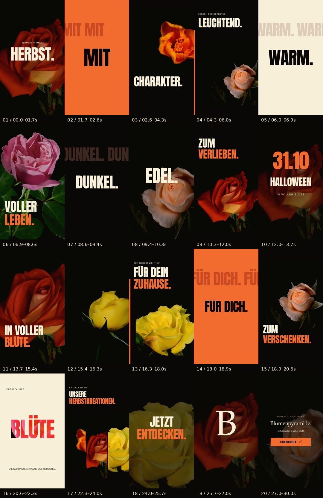

# Blumenpyramide — V3

[Télécharger le film](Blumenpyramide-V3-Film-HD.mp4?raw=true) · [Version légère](Blumenpyramide-V3-Film-leger.mp4?raw=true) · [Sources modifiables](Blumenpyramide-V3-Sources.zip?raw=true)

Publicité verticale de 30 secondes, 720 × 1280, 60 images/seconde. Vingt séquences, musique originale à 140 BPM, véritables ouvertures de fleurs en vidéo, typographie animée et transitions WebGL.

Cette refonte remplace les bouquets photographiques animés et les pétales décoratifs des versions précédentes. Le projet combine Remotion 4.0.536, ses transitions et son flou de mouvement, le shader crosswarp issu de GL Transitions, ainsi qu'une révélation de caractères adaptée du projet MIT remotion-scenes. Une composition HyperFrames de lecture du film est incluse.

Les sources contiennent une composition de 1080 × 1920 avec les clips préparés, les polices, la musique et les licences. Le rendu est livré en 720p ; Adobe After Effects n'est pas installé et les sources ne sont pas un fichier `.aep`. Voir `README-FR.md` dans le ZIP pour l'installation et les commandes de rendu.

Les deux MP4 ont été décodés intégralement avec FFmpeg et vérifiés par FFprobe : 30 secondes, 1800 images, 60 images/seconde, vidéo H.264 et audio AAC stéréo. Les métadonnées et empreintes sont dans [VALIDATION.json](VALIDATION.json).

Les médias proviennent du projet Creative Commons [Blooming Data de Joe Hall](https://github.com/joefhall/blooming-data). Crédits originaux : GalaxyMikeDE, anastasia moraiti, TheChokAAA et Awesome Video. Conserver les [crédits complets](MEDIA-CREDITS.md) dans la description d'une publication. Les séquences génériques ne constituent pas un catalogue vérifié de Blumenpyramide.

Swishy, Pexels et Mixkit ont renvoyé un refus réseau dans cette session. Aucun média de ces sites n'est utilisé. Les recherches et les dépendances effectivement retenues sont documentées dans les sources.
