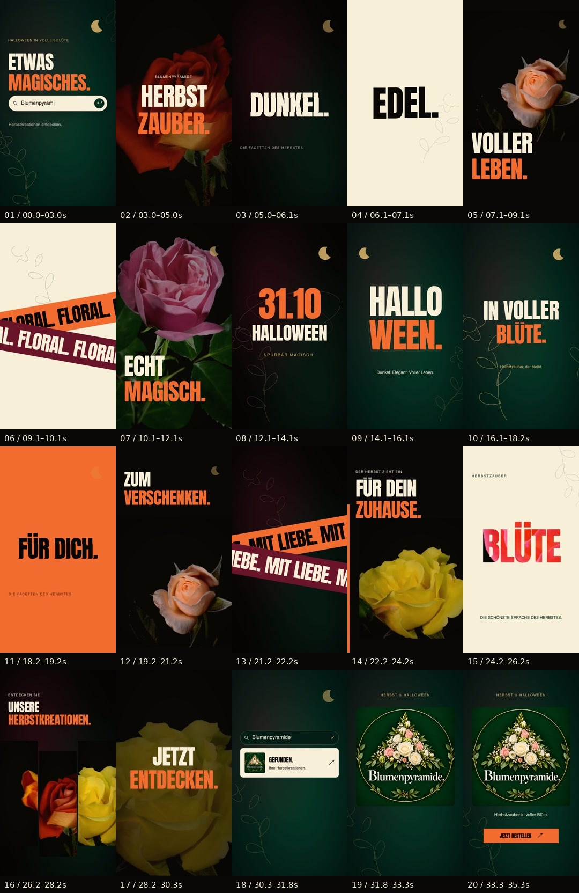

# Blumenpyramide — V4 Spooky Floral

[Télécharger le film 1080p](Blumenpyramide-V4-Spooky-Floral-HD.mp4?raw=true) · [Version légère 720p](Blumenpyramide-V4-Spooky-Floral-leger.mp4?raw=true) · [Sources Remotion](Blumenpyramide-V4-Sources.zip?raw=true)

**35,3 secondes · vertical 9:16 · 60 images/seconde · 119 BPM**.

Cette révision ajoute une barre de recherche qui tape « Blumenpyramide », un clic, un rebond et un zoom, des lettres qui s'assemblent par bandes, des rubans typographiques qui se croisent, des orbites, une lune et des tracés botaniques animés. La fin montre le logo floral fourni dans la conversation et l'appel « Jetzt bestellen ».

Le tempo baisse de **140 à 119 BPM**, soit **15 %**. Le film conserve vingt séquences sur soixante-dix beats, désormais répartis sur 35,3 secondes. Le master est en **1080 × 1920** ; la copie légère est en **720 × 1280**. Le texte et les éléments 2D sont rendus en 1080p ; les plans de fleurs proviennent toujours de séquences originales en 720p.

La musique originale devient plus sombre et feutrée : basse, cloches, nappes mineures et bruitages synchronisés sur la saisie et les clics. La nouvelle palette associe le vert profond du logo au noir, au bordeaux, à l'orange et à l'or.

Le projet utilise **Remotion**, **GSAP** pour les courbes de mouvement de la recherche et du résultat, ainsi que **GL Transitions** et une technique de révélation de caractères adaptée de **remotion-scenes**. Un lecteur de livraison **HyperFrames** est inclus. Les sources Remotion sont modifiables ; elles ne constituent pas un fichier After Effects `.aep` natif.

Les deux MP4 ont été contrôlés par FFprobe et décodés intégralement avec FFmpeg : 2118 images à 60 images/seconde, H.264 et audio AAC stéréo. Les empreintes SHA-256 et métadonnées sont dans [VALIDATION.json](VALIDATION.json).

Fleurs vidéo : [Blooming Data de Joe Hall](https://github.com/joefhall/blooming-data), avec crédits originaux à GalaxyMikeDE, anastasia moraiti, TheChokAAA et Awesome Video. Conserver les [crédits complets](MEDIA-CREDITS.md) dans la description d'une publication. Les images génériques ne sont pas un catalogue vérifié des produits de Blumenpyramide.
